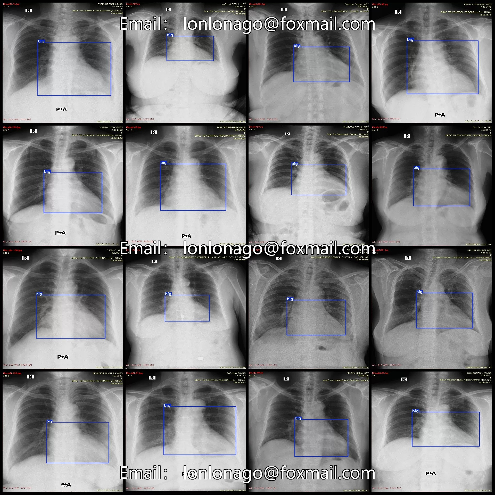
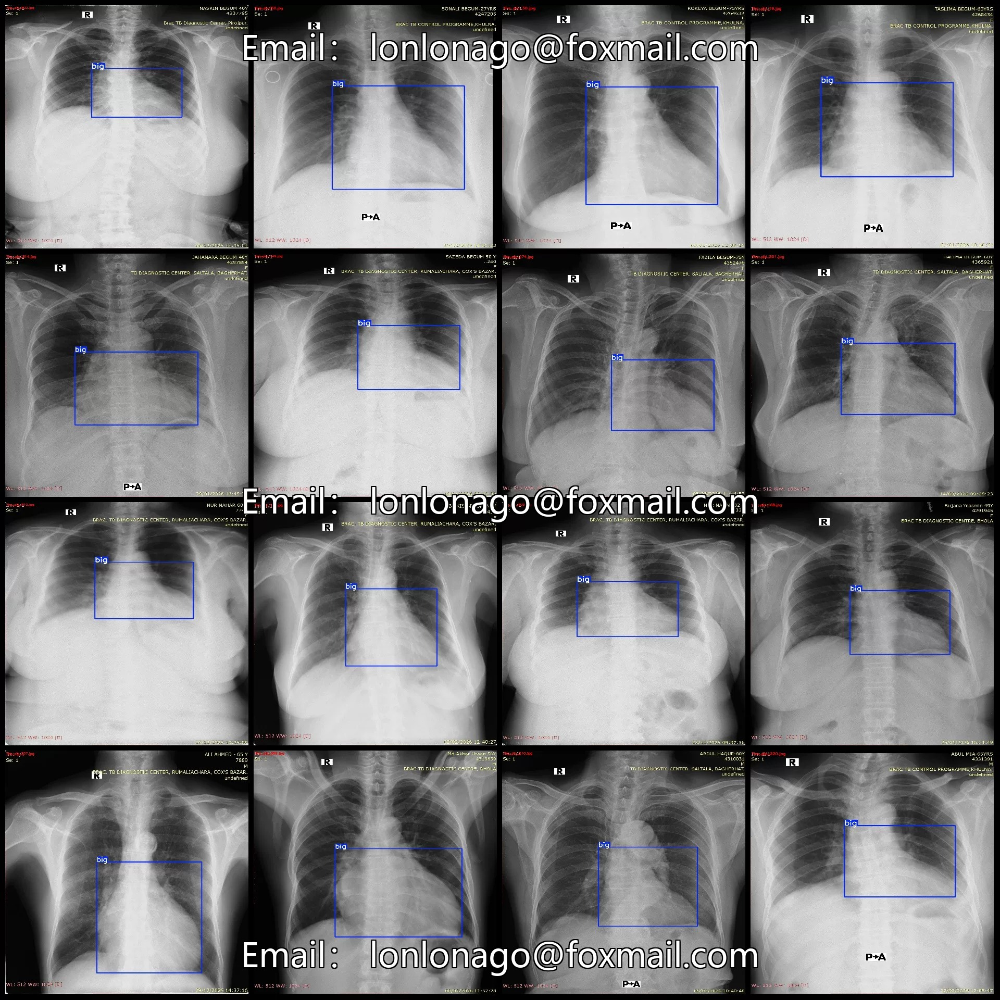
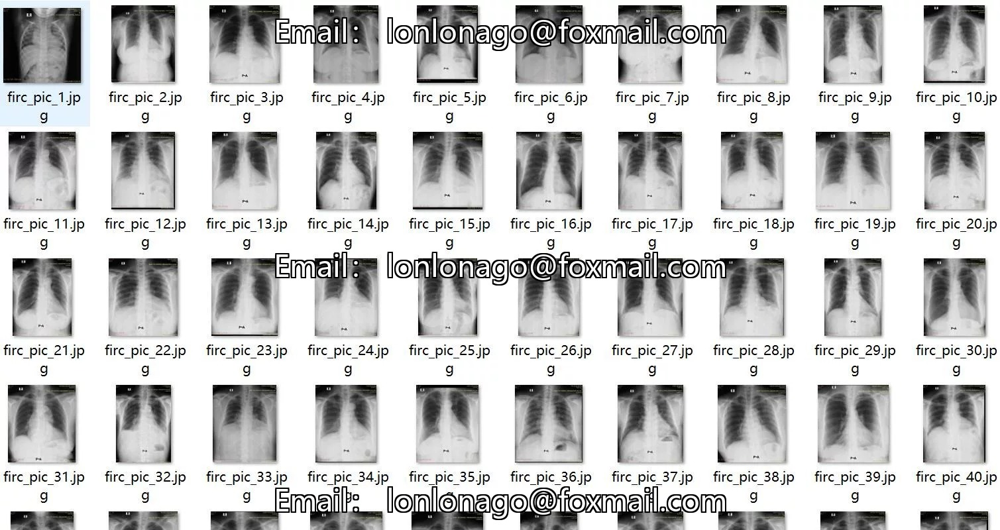
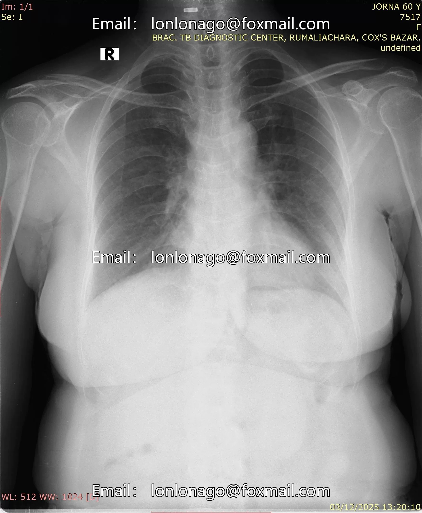
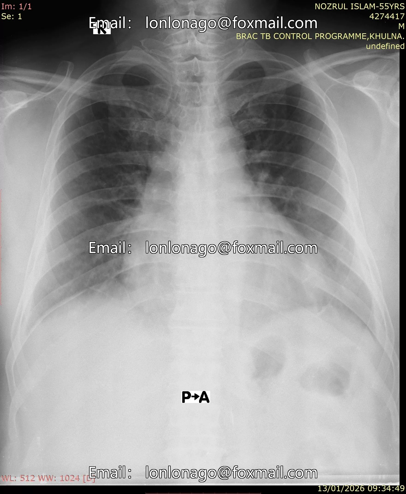
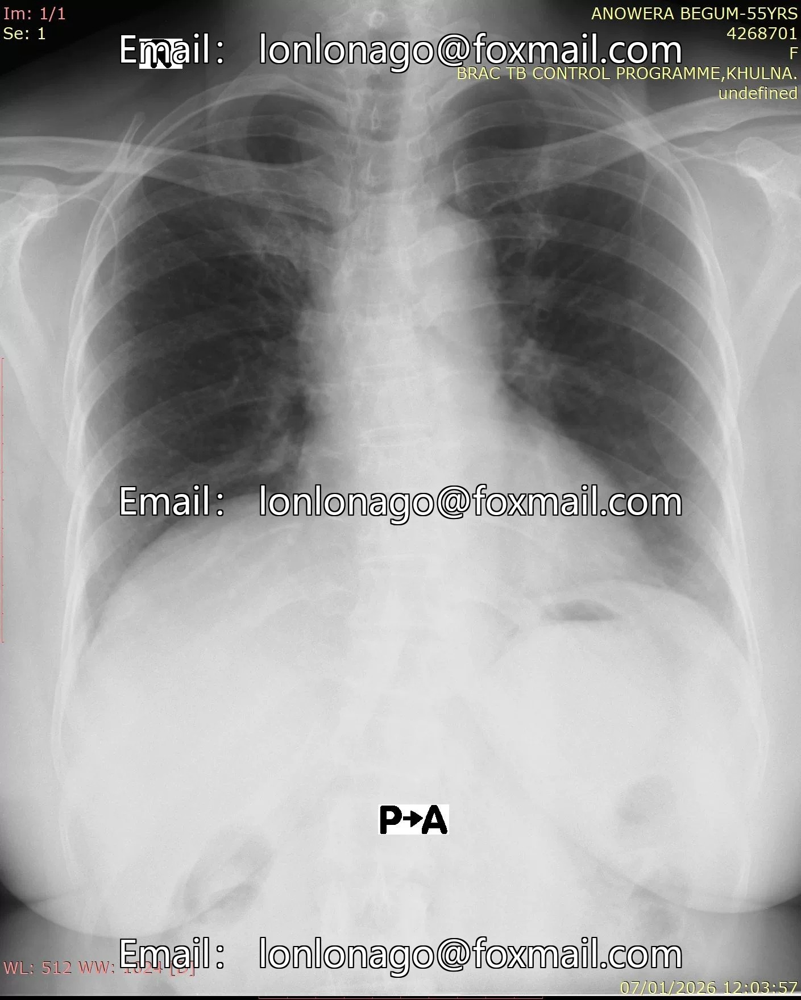

# Intelligent Medical CT Image Heart Hypertrophy Detection Dataset VOC+YOLO format 427

## Body

427 VOC+YOLO formatted dataset for Heart Hypertrophy Detection in CT Images

Precaution: Due to the dataset's replicability, please confirm compliance with requirements before purchasing.
Dataset format: PascalVOC format + YOLO format (txt file without split path, only containing jpg images and corresponding VOC format xml files and yolo format txt files)
Number of images (jpg file count): 427
Number of annotations (xml file count): 427
Number of annotations (txt file count): 427
Number of annotation categories: 1
Annotation category names: ["big"]
For each category, the number of bounding boxes and the image occupied by each annotation are as follows:

Number of big frames = 427, occupying a total number of images = 427
Total frame count: 427
Image resolution: Multi-resolution images, such as 1535x1946, 1376x1760, etc.
Labeling tool used: labelImg
Labeling rules: Draw rectangles around the categories.
Important note: The dataset does not include splitting into training, validation, and test sets; you need to do this yourself.
Special declaration: This dataset does not guarantee the accuracy of the trained models or weight files.

## Images

## Payment

Here is a pay link on Stripe ( https://buy.stripe.com/3cs8yP7sY87d0vu9AB ). Please contact me lonlonago@foxmail.com after funding $89, and I will send you a complete data files , thank you!

